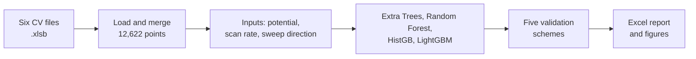
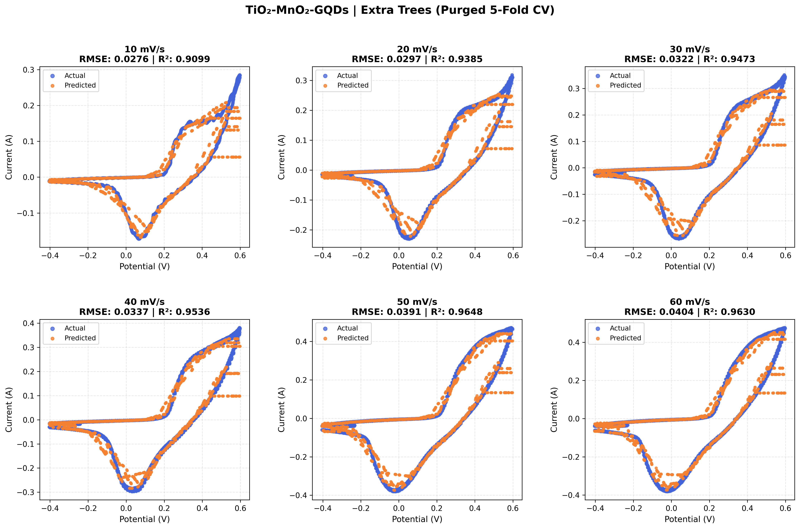
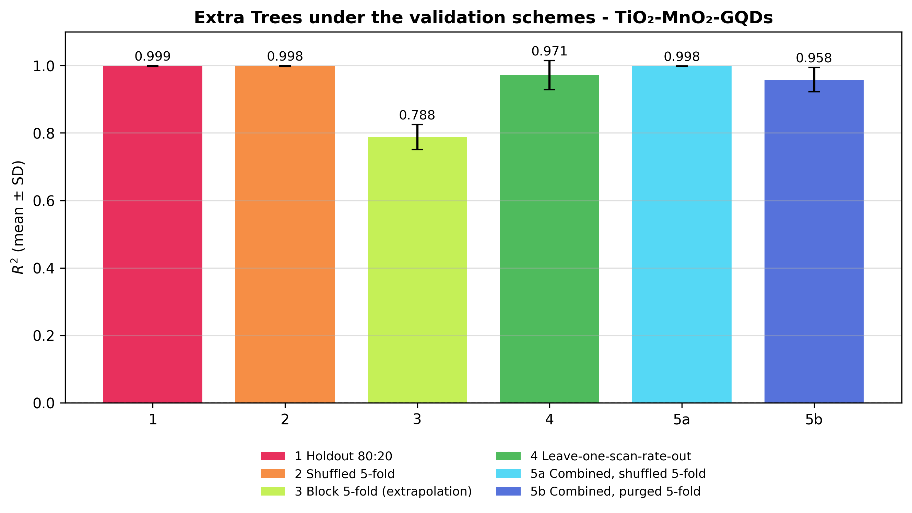

<h1 align="center">tio2-mno2-gqds-cv-ml</h1>

<p align="center">
  Machine-learning analysis of cyclic voltammograms of <b>TiO₂-MnO₂-GQDs</b><br>
  five validation schemes · four tree models · reproducible notebook
</p>

<p align="center">
  
  
  
  <a href="https://doi.org/10.5281/zenodo.XXXXXXX"></a>
  <a href="https://colab.research.google.com/github/comsian-material-lab/tio2-mno2-gqds-cv-ml/blob/main/ML_REPORT_TiO2-MnO2-GQDs.ipynb"></a>
</p>

---

## Table of contents

1. [Overview](#overview)
2. [Workflow](#workflow)
3. [Key results](#key-results)
4. [Quick start](#quick-start)
5. [Repository structure](#repository-structure)
6. [Data](#data)
7. [Methods](#methods)
8. [Outputs](#outputs)
9. [Reproducibility](#reproducibility)
10. [Troubleshooting](#troubleshooting)
11. [Limitations and roadmap](#limitations-and-roadmap)
12. [Citation](#citation)
13. [License and contact](#license-and-contact)

## Overview

This repository holds the code, data and results for predicting the current of a **TiO₂-MnO₂-GQDs** electrode from **potential**, **scan rate** and **sweep direction**, using cyclic voltammograms (CVs) recorded at six scan rates (10–60 mV s⁻¹).

The aim is an honest check of how well the models generalise. Validation ranges from random splits (optimistic) to purged cross-validation and leave-one-scan-rate-out (demanding), so the reported scores are not inflated by leakage between neighbouring points of a curve.

## Workflow



## Key results

**Extra Trees under the validation schemes**

| Scheme | What is held out | R² |
|---|---|---|
| 1–2 Random holdout / shuffled 5-fold (per curve) | random points of one curve | ≈ 0.998 |
| 3 Block 5-fold (per curve) | contiguous curve segments | 0.79 |
| 4 Leave-one-scan-rate-out | a complete scan-rate curve | 0.971 ± 0.043 |
| 5b Purged 5-fold (combined model) | whole potential bands with a buffer | 0.958 ± 0.036 |

Random-split scores mainly reflect interpolation between neighbouring points and overstate predictive performance.

<table>
<tr>
<td valign="top">

**Models, purged 5-fold R²**

| Model | R² |
|---|---|
| Extra Trees | 0.958 ± 0.036 |
| HistGB | 0.916 ± 0.042 |
| Random Forest | 0.907 ± 0.051 |
| LightGBM | 0.900 ± 0.051 |
| HistGB, tuned | 0.878 ± 0.074 |

</td>
<td valign="top">

**Feature ablation (Extra Trees)**

| Inputs | R² |
|---|---|
| Potential only | 0.394 |
| + sweep direction | 0.800 |
| + scan rate | 0.527 |
| All three | 0.958 |

</td>
</tr>
</table>

- Sweep direction contributes more than scan rate.
- Split-conformal 90% intervals cover only about 64% of held-out points, so uncertainty is under-estimated.
- The lowest leave-one-scan-rate-out score is at 10 mV s⁻¹ (R² = 0.886), where the model has to extrapolate to the smallest currents.

<p align="center">
  
</p>
<p align="center">
  
</p>

## Quick start

```bash
git clone https://github.com/comsian-material-lab/tio2-mno2-gqds-cv-ml.git
cd tio2-mno2-gqds-cv-ml
pip install -r requirements.txt
```

Point the notebook to the `data` folder before starting Jupyter:

```bat
:: Windows (Command Prompt)
set CV_DATA_DIR=data
jupyter notebook
```

```bash
# macOS / Linux
export CV_DATA_DIR=data
jupyter notebook
```

Open `ML_REPORT_TiO2-MnO2-GQDs.ipynb` and choose **Run All**.

<details>
<summary><b>Google Colab</b></summary>

Click the **Open in Colab** badge, run the first cell and upload the six `.xlsb` files from `data/` when prompted. Then run the remaining cells.

</details>

<details>
<summary><b>Run-time options</b></summary>

| Setting (first cell) | Default | Effect |
|---|---|---|
| `NESTED_TUNING` | `True` | Bayesian tuning of HistGB inside each purged fold. Set `False` to save most of the run time. |
| `RUN_STANDARD_CV` | `True` | Shuffled 5-fold for all models (optimistic reference). |
| `TUNE_ITER` | `15` | Number of Bayesian search iterations. |
| `SWEEP_WINDOW` / `SWEEP_MIN_RUN` | `21` / `60` | Smoothing window and minimum run length for the sweep-direction labels. |
| `DATA_DIR` | `.` | Folder with the data files (also set by `CV_DATA_DIR`). |

A full run takes about 12 minutes on one CPU.

</details>

## Repository structure

```
tio2-mno2-gqds-cv-ml/
├── ML_REPORT_TiO2-MnO2-GQDs.ipynb   analysis notebook
├── requirements.txt                  Python packages
├── README.md
├── LICENSE
├── data/                             raw CV files (one per scan rate)
├── Results/                          Excel report and figures
└── Src/                              scripts
```

## Data

| Scan rate (mV s⁻¹) | File |
|---|---|
| 10 | `10_CV_FINAL.xlsb` |
| 20 | `20_cv_final.xlsb` |
| 30 | `30_cv_final.xlsb` |
| 40 | `40_cv_final.xlsb` |
| 50 | `50_final1.xlsb` |
| 60 | `60_cv_final.xlsb` |

Each file holds potential (V) and current (A) for one curve. The potential window is about −0.40 to +0.60 V, and the six curves total 12,622 points. Other recorded runs (duplicates, outliers and repeats) were not used.

## Methods

- **Inputs:** potential, scan rate (mV s⁻¹) and sweep direction (1 = increasing potential, 0 = decreasing). The sweep direction is inferred from the data order by smoothing the potential and merging short direction runs, which gives two direction changes per curve (one CV cycle).
- **Models:** Extra Trees and Random Forest (200 trees), HistGB and LightGBM (library defaults), random seed 42. HistGB is also tuned by nested Bayesian search.
- **Validation schemes:**
  1. random 80:20 holdout (per curve)
  2. shuffled 5-fold (per curve)
  3. block 5-fold (per curve, contiguous segments)
  4. leave-one-scan-rate-out
  5. combined model with shuffled (5a) and purged (5b) 5-fold cross-validation
- **Purged cross-validation:** the potential axis is split into 200 bands of about 63 points (all scan rates and sweep directions), 40 random bands form each test fold, and three bands on each side are removed from training.
- **Extras:** feature ablation, split-conformal 90% intervals, SHAP importance, alternating hold-out (train 10/30/50, test 20/40/60 mV s⁻¹).

## Outputs

Everything is written to `RESULTS_TiO2-MnO2-GQDs/` when the notebook runs.

| Output | Content |
|---|---|
| `ML_REPORT_TiO2-MnO2-GQDs.xlsx` | all tables: validation summary, leave-one-scan-rate-out, purged-CV models, feature ablation, uncertainty, fold sizes, data files, sweep check |
| `*_scatter_ET.png` | experimental vs predicted CV curves (purged 5-fold) |
| `validation_schemes_comparison.png` | Extra Trees under the validation schemes |
| `feature_ablation.png`, `shap_importance.png` | feature importance |
| `sweep_direction_check.png`, `cv_curves.png` | data checks |

## Reproducibility

- Fixed random seed (42) for models and for the assignment of potential bands to folds.
- Results are deterministic for the same package versions. After a successful run, record your versions with `pip freeze > requirements-lock.txt`.
- The notebook was run end to end on one CPU before release.

## Troubleshooting

| Problem | Fix |
|---|---|
| `FileNotFoundError` for a `.xlsb` file | Put the six files next to the notebook, or set `CV_DATA_DIR=data` before starting Jupyter. |
| `pyxlsb` or `skopt` not found | Run `pip install pyxlsb scikit-optimize`. |
| Run takes too long | Set `NESTED_TUNING = False`. |
| Figures missing in this README | Upload the PNG files to `Results/` with the exact names used above. |

## Limitations and roadmap

**Limitations**

- One electrode and one curve per scan rate, with no independent replicate held out.
- The best model was chosen on the same folds that are reported, so scores may be slightly optimistic.
- The sweep direction is inferred from the data order, not recorded.
- The models reconstruct the measured CV response of this electrode. They are not shown to predict independent experiments or other materials.

**Roadmap**

- [ ] Replicate CV curves as an independent test set
- [ ] Record sweep direction or a time index during acquisition
- [ ] Add more materials and test leave-one-material-out validation
- [ ] Local or Mondrian conformal intervals

## Citation

If you use this code or data, please cite the archived release:

```bibtex
@software{tio2_mno2_gqds_cv_ml,
  author    = {[Authors]},
  title     = {tio2-mno2-gqds-cv-ml},
  version   = {v1.0.0},
  publisher = {Zenodo},
  doi       = {10.5281/zenodo.XXXXXXX},
  url       = {https://doi.org/10.5281/zenodo.XXXXXXX}
}
```

> Replace `XXXXXXX` with your Zenodo record number after the first release.

## License and contact

Code: MIT License. Data: CC BY 4.0 (if you allow reuse).

Safi Ullah Majid
Comsat's University Islamabad
Safeullahmajid@gmail.com
